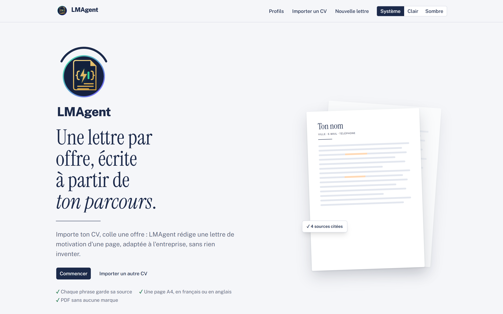
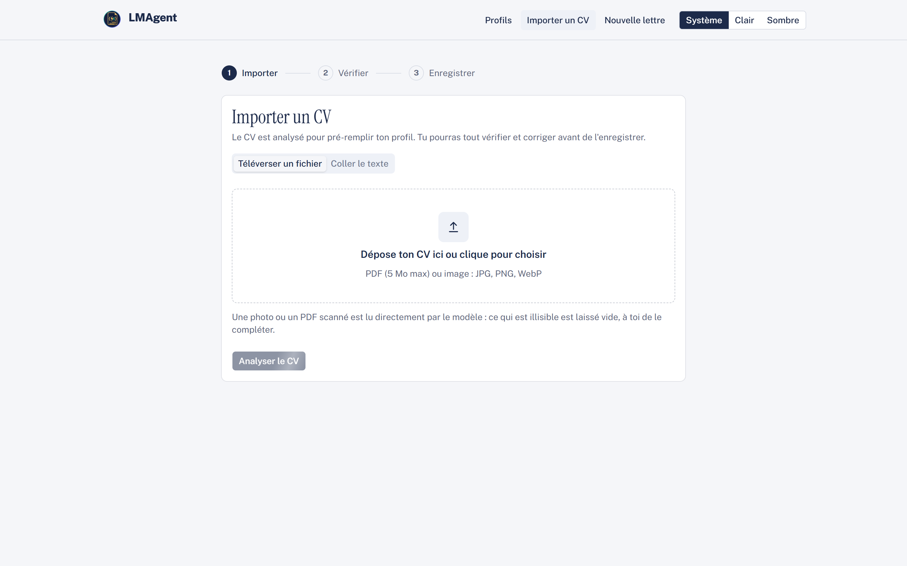
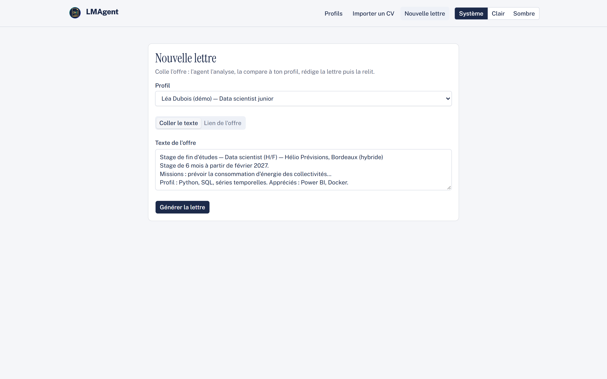
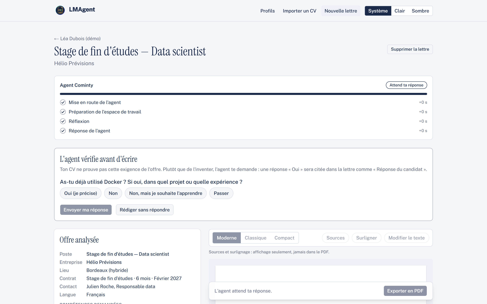
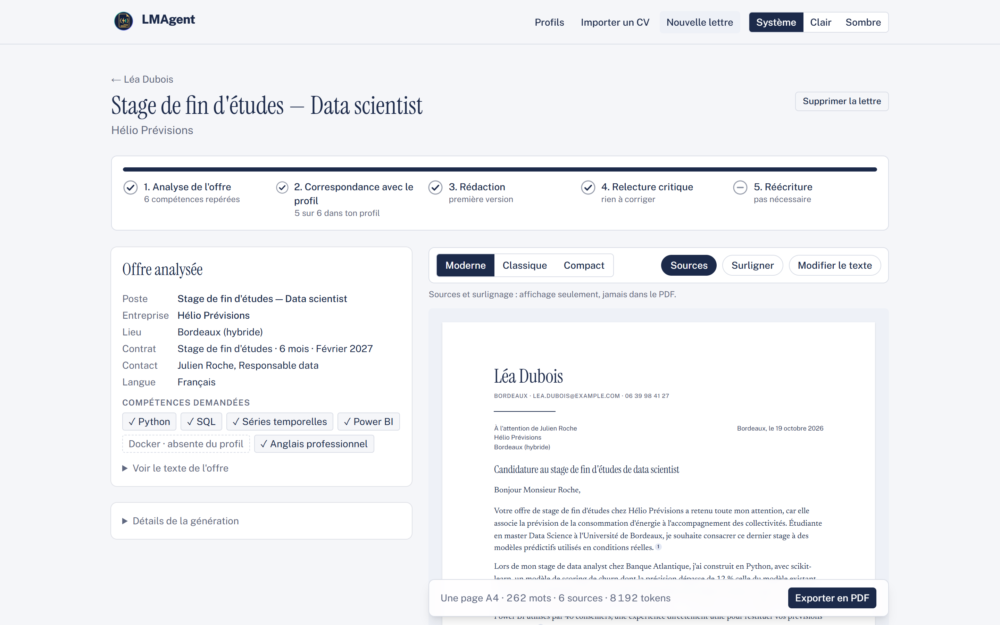
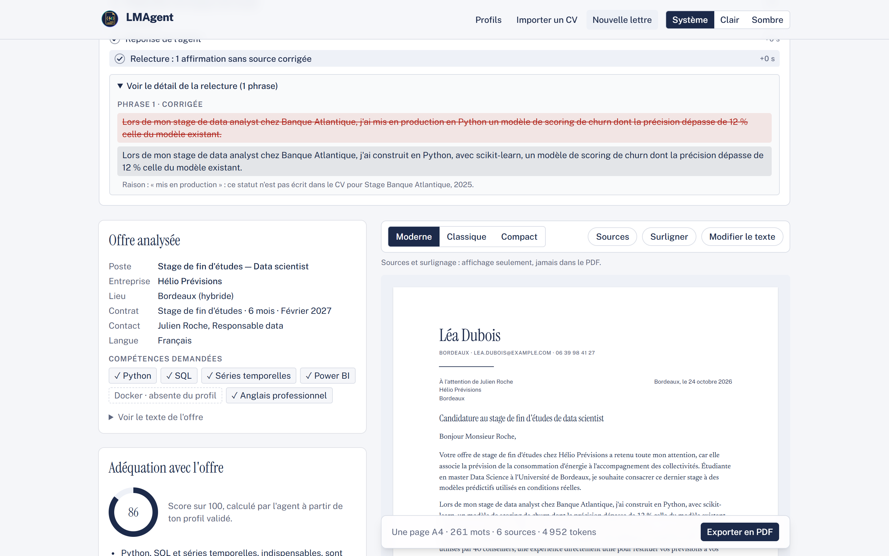

<div align="center">


# LMAgent

**Lettre de Motivation Agent** : une lettre de motivation par offre, écrite par un agent Cominty à partir de ton parcours, sans rien inventer.

**[Essayer la version en ligne](https://lmagent-production.up.railway.app)**




</div>

## En bref

Une lettre de motivation générique se repère tout de suite, et une IA qui « enjolive » le CV fait plus de tort que de bien.
LMAgent confie la lettre à un **agent managé Cominty** qui lit ton CV et l'offre, **te pose des questions** sur ce
que ton CV ne prouve pas, écrit la lettre, puis la fait **relire par le code** : chaque phrase cite ses sources, et
toute affirmation qui n'est pas écrite dans ton CV ou dans tes réponses est corrigée ou retirée.

## Le parcours

| | |
|---|---|
| **1. Import du CV**<br>PDF, scan, photo ou texte collé. L'agent l'extrait en profil structuré, que tu vérifies et corriges. |  |
| **2. L'offre**<br>Texte collé ou lien (lu côté serveur). L'agent l'analyse : poste, entreprise, contact, compétences demandées. |  |
| **3. Questions au candidat**<br>Pour chaque exigence que ton CV ne prouve pas (3 au plus), l'agent pose une question native Cominty : Oui (je précise), Non, Je souhaite l'apprendre, Passer. |  |
| **4. La lettre**<br>250 à 300 mots, dans la langue de l'offre, avec un score d'adéquation et des ajustements du CV. Chaque phrase est reliée à ses sources (« Stage Banque Atlantique, 2025 », « Réponse du candidat »). |  |
| **5. Relecture des preuves**<br>Le code repère les statuts transférés (« mis en production »), les verbes renforcés, les termes repris de l'offre sans preuve et les répétitions. L'agent corrige seulement ces phrases ; le avant / après reste visible. Puis export PDF A4. |  |

## Comment LMAgent utilise l'agent Cominty

Toute l'IA passe par Cominty : il n'y a aucun autre fournisseur de modèle.

- **Deux agents managés** : l'agent des lettres (analyse, questions, rédaction, correction) et un agent rapide pour
  l'extraction du CV et le résumé du profil.
- **Client REST maison** (`lib/cominty`, d'après le SDK Python officiel) : création et suite de conversation, flux
  JSONL repris là où il s'est coupé (`last-event-id`), annulation, questions natives, fichiers joints (CV scanné).
- **Une conversation par lettre, en tours** :
  1. analyse de l'offre et questions natives ;
  2. lettre complète, en tenant compte des réponses (sans réécrire l'analyse) ;
  3. si la relecture trouve un problème, correction **ciblée** : seules les phrases signalées sont renvoyées.
     Une phrase encore fausse est retirée, sans nouveau tour.
- **Étapes en direct** : chaque événement du flux (réflexion, outils, réponse) s'affiche dans une frise. Tu peux
  quitter la page, le serveur suit l'agent jusqu'au bout.
- **Contrat vérifié par le code** : JSON validé par Zod, ids de sources limités au profil et aux réponses, une
  relance automatique si le format est faux.
- **Protection des crédits** : code d'accès pour tout vrai appel, plafond de dépense, coût de chaque tour enregistré.

## Architecture et choix techniques

```
Navigateur ── Server Actions ──► lib/letters/agent-run.ts ──► lib/cominty (REST + flux JSONL) ──► Agent Cominty
    ▲                                   │
    └──── étapes en direct (SSE) ───────┤
                                        ├─► lib/agent : contrat JSON, sources, relecture des preuves
                                        └─► Prisma + libSQL (SQLite) : profils, lettres, tours, étapes, coûts
```

| Choix | Pourquoi |
|---|---|
| Next.js 16 (App Router, Server Actions), TypeScript strict | Clés API uniquement côté serveur, une seule base de code |
| Zod pour chaque sortie de l'agent | Le modèle ne peut citer qu'une source qui existe ; erreurs précises renvoyées à l'agent |
| Relecture déterministe dans le code | Une règle vérifiable vaut mieux qu'une consigne au modèle : rien n'est affirmé sans preuve |
| Tours et étapes enregistrés en base | Reprise après coupure, rejeu au rechargement, coût par tour |
| SQLite via libSQL, Prisma 7 | Déploiement simple (un volume), recherche plein texte FTS5 prête pour les documents |
| Un composant React pour l'aperçu et le PDF | Ce que tu vois est ce qui est exporté (puppeteer-core, métadonnées neutralisées) |
| Faux agent `mock` | Tests et démo hors ligne, sans crédit |

## Lancer le projet en local

Prérequis : [Bun](https://bun.sh), Node.js 20+, Edge ou Chrome (export PDF). Un compte Cominty est **facultatif** :
le mode `mock` fonctionne sans réseau.

```bash
git clone https://github.com/fedifedifedi/LMAgent.git
cd LMAgent
git checkout cominty
bun install                     # génère aussi le client Prisma
cp .env.example .env.local      # LLM_PROVIDER=mock par défaut
bunx prisma migrate deploy      # crée prisma/dev.db
npm run dev                     # http://localhost:3000
```

| Commande | Action |
|---|---|
| `npm test` | Tests (`bun test`, base temporaire, aucun appel réel) |
| `npm run demo:seed` | Base de démo fictive (Léa Dubois) dans un dossier temporaire |
| `npm run cominty:smoke` | Un vrai appel à Cominty : consomme des crédits |

Variables (`.env.example`) : `LLM_PROVIDER` (`mock` ou `cominty`), `COMINTY_API_KEY`, `COMINTY_USER_ID`,
`COMINTY_AGENT_ID`, `COMINTY_EXTRACT_AGENT_ID` (facultatif), `CHROME_PATH`.

<details>
<summary>Déploiement sur Railway</summary>

Le `Dockerfile` (Node 22, Bun, Chromium) et `railway.json` construisent l'image et appliquent les migrations au démarrage.
Monter un volume sur `/data` (base SQLite), définir `LLM_PROVIDER=cominty`, les identifiants Cominty,
`DEMO_ACCESS_CODE` et `COMINTY_BUDGET_USD`, puis générer un domaine.

</details>

## Version en ligne

**https://lmagent-production.up.railway.app**

- **Sans code** : le bouton « Essayer avec un profil de démo » rejoue un vrai run de l'agent, enregistré, avec le
  même affichage en direct et sans aucun appel.
- **Avec le code d'accès** (fourni au jury dans le message de candidature) : saisi sur la page `/acces`, il permet
  d'importer un CV et de faire écrire une vraie lettre par l'agent Cominty.
- Une génération complète prend **plusieurs minutes**, à cause du raisonnement de l'agent (analyse, rédaction,
  correction). Tu peux quitter la page et revenir : la lettre sera prête.

Toutes les captures de ce README montrent un profil fictif (Léa Dubois), générées en mode `mock`.

## Améliorations prévues

- **Recherche web sur l'entreprise** : l'agent consulte la page de l'offre et le site de l'entreprise, et cite ces
  pages comme sources de faits sur l'entreprise.
- **Réduction du temps de génération** : niveau de raisonnement réglé, ou agent rédacteur dédié avec un modèle plus
  rapide, côté configuration Cominty.
- Bouton « Raccourcir la lettre » quand elle dépasse une page, même à 10 pt.
- Documents du profil (rapports de stage, recommandations) comme sources, avec recherche hybride.
- Comptes utilisateurs : aujourd'hui, il n'y a pas d'authentification.
