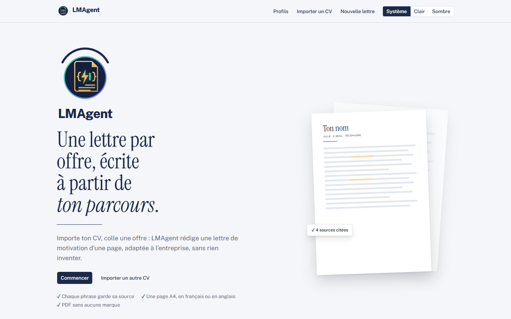
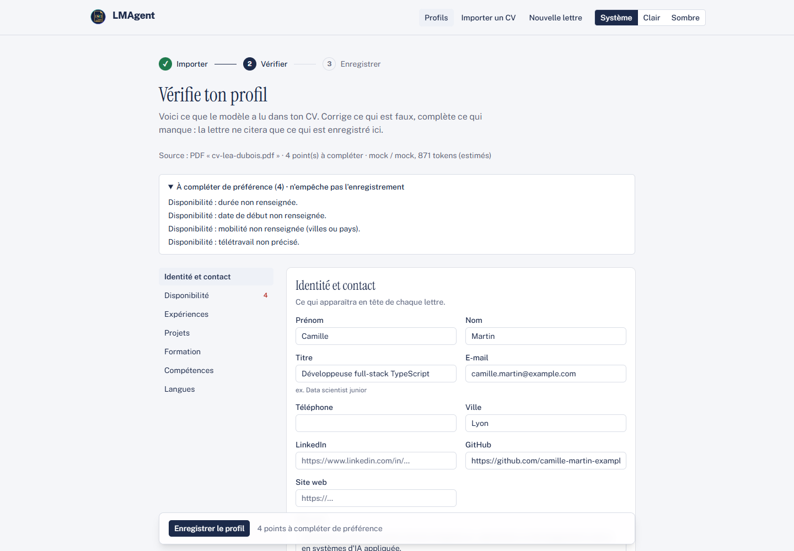
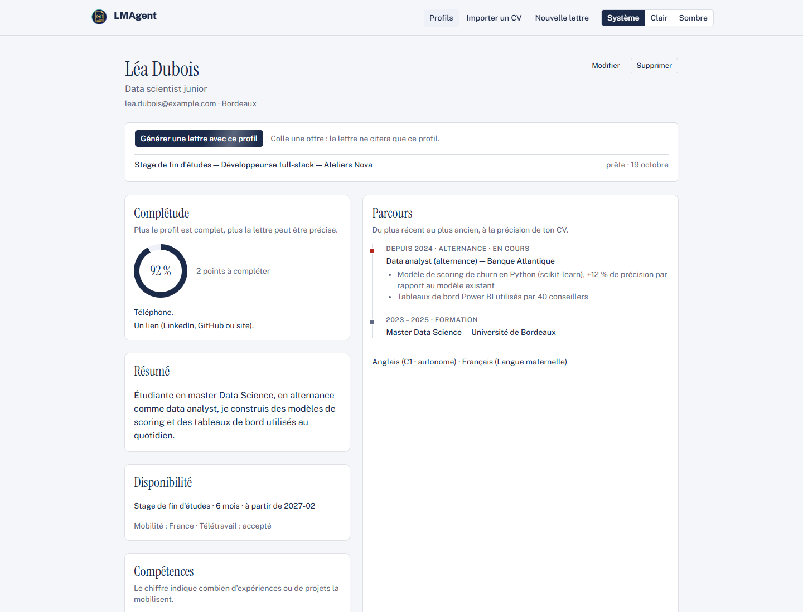
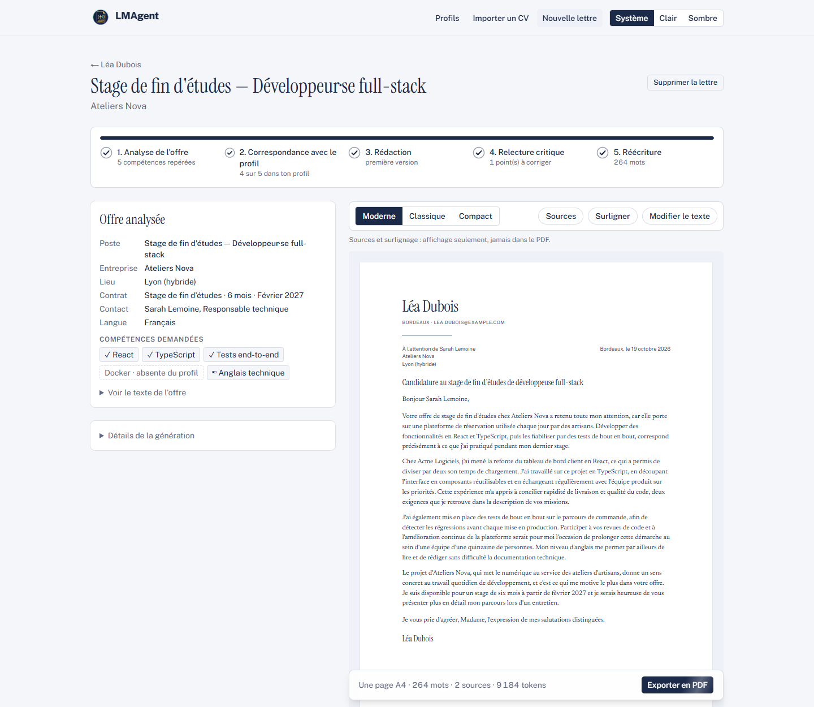
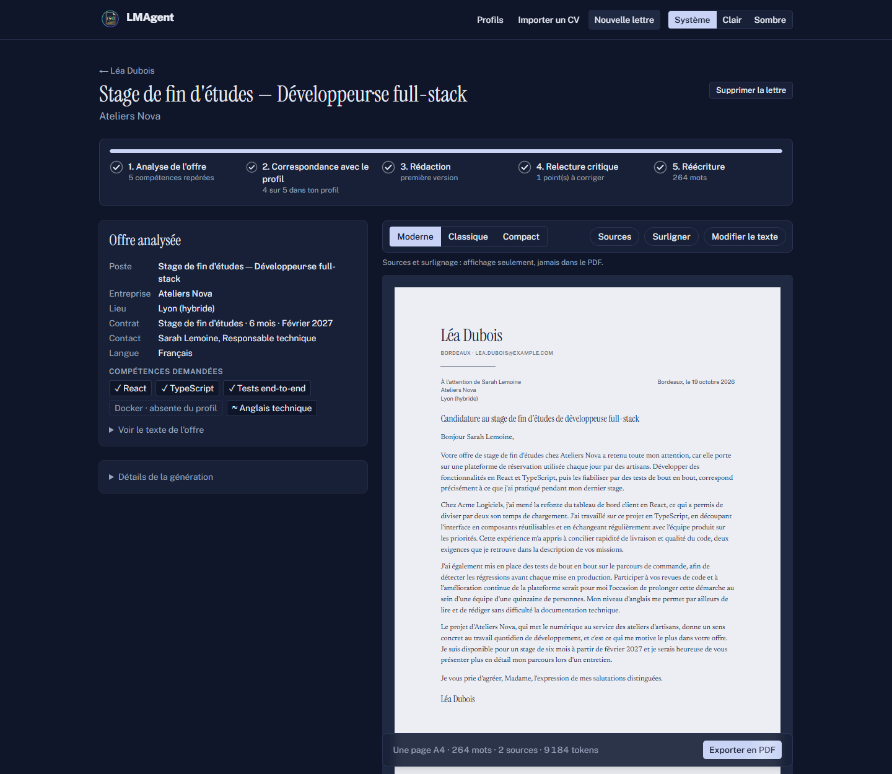

<div align="center">


# LMAgent

**Lettre de Motivation Agent** : une lettre de motivation par offre d'emploi, écrite à partir de ton parcours, sans rien inventer.




</div>

## Présentation

LMAgent transforme un CV en lettres de motivation ciblées. L'utilisateur importe son CV (PDF, image ou texte collé).
Un modèle de langage en extrait un profil structuré, que l'utilisateur vérifie et corrige avant de l'enregistrer.
Pour chaque offre d'emploi (texte collé ou lien), un agent en plusieurs étapes rédige ensuite une lettre d'une page,
dans la langue de l'offre.

Le principe central est la **traçabilité** : chaque phrase de la lettre est reliée aux éléments du profil qui la justifient.
Le modèle ne peut citer qu'une source qui existe dans le profil validé, et des vérifications dans le code
signalent toute compétence revendiquée qui n'y figure pas.

## Fonctionnalités

**Import du CV**
- PDF avec texte, PDF scanné, photo (JPG, PNG, WebP) ou texte collé ; glisser-déposer.
- Extraction vers un schéma Zod strict ; les dates gardent la précision du CV (jamais de mois ou de jour inventé).
- Lecture native par le modèle pour les images et les scans ; les passages illisibles sont laissés vides, pas devinés.

**Vérification du profil**
- Formulaire complet avec sommaire latéral, avertissements par section et brouillon conservé localement.
- Détection des quasi-doublons de compétences, fusion d'un projet dans une expérience, résumé proposé par le modèle.
- Fiche du profil : taux de complétude, parcours chronologique, compétences et nombre d'expériences qui les mobilisent.

**Génération de la lettre**
- Offre collée ou lue depuis un lien (JSON-LD `JobPosting` puis Readability, protégé contre le SSRF).
- Pipeline : analyse de l'offre → correspondance avec le profil → rédaction → relecture critique → au plus une réécriture.
- Contrôles du code : 250 à 350 mots, langue de l'offre, compétences absentes du profil, contact nommé dans l'offre.
- Pipeline reprenable : en cas d'erreur (par exemple un quota atteint), la lettre reprend à l'étape interrompue.
- Suivi des tokens de chaque appel au modèle.

**Aperçu, retouches et PDF**
- Trois mises en page (Moderne, Classique, Compact), un seul composant React pour l'aperçu et le PDF.
- Sources et surlignage des compétences demandées, à l'affichage seulement.
- Modification du texte : une phrase retouchée est marquée « modifiée par toi » ; retour possible à la version générée.
- Export PDF A4 d'une page, avec réduction automatique du texte (jusqu'à 10 pt) et métadonnées neutralisées.

**Interface**
- Thème clair et sombre, animations GSAP sur l'accueil, apparitions discrètes ailleurs.
- Respect de `prefers-reduced-motion`.

## Captures d'écran

| Import du CV | Vérification du profil |
|---|---|
|  |  |

| Fiche du profil | Lettre générée |
|---|---|
|  |  |

<details>
<summary>Lettre en thème sombre</summary>



</details>

Les captures utilisent des profils fictifs et le provider `mock`.

## Technologies

| Domaine | Choix |
|---|---|
| Application | Next.js 16 (App Router, Cache Components, Server Actions), React 19, TypeScript strict |
| Interface | Tailwind CSS 4, shadcn/ui (Base UI), GSAP + SplitText, Lenis |
| Formulaires et validation | react-hook-form, Zod |
| Données | Prisma 7, SQLite via libSQL, recherche plein texte FTS5 |
| Modèles de langage | Google Gemini (`@google/genai`), Anthropic Claude (`@anthropic-ai/sdk`), provider `mock` hors ligne |
| Documents | unpdf (texte des PDF), Readability + linkedom (offres en ligne), puppeteer-core + pdf-lib (export PDF) |
| Tests | `bun test`, base SQLite temporaire migrée |

La couche LLM (`lib/llm`) isole les providers : validation Zod des sorties, relances avec l'erreur renvoyée au modèle,
schéma tolérant en dernier recours et comptage des tokens. Les étapes simples peuvent utiliser un modèle plus léger
(`LLM_MODEL_FAST`).

## Installation

### Prérequis

- [Bun](https://bun.sh) (gestion des paquets et tests) et Node.js 20 ou plus récent.
- Pour l'export PDF : Microsoft Edge ou Google Chrome installé localement.
- Une clé API Gemini ou Anthropic, **facultative** : le provider `mock` fonctionne sans clé.

### Étapes

```bash
git clone https://github.com/fedifedifedi/LMAgent.git
cd LMAgent
bun install                     # génère aussi le client Prisma (postinstall)
cp .env.example .env.local      # puis compléter .env.local
bunx prisma migrate deploy      # crée la base SQLite prisma/dev.db
npm run dev                     # http://localhost:3000
```

### Configuration (`.env.local`)

| Variable | Rôle |
|---|---|
| `LLM_PROVIDER` | `mock` (défaut, sans clé), `gemini` ou `anthropic` |
| `LLM_MODEL` | Identifiant exact du modèle, obligatoire hors `mock` |
| `LLM_MODEL_FAST` | Facultatif : modèle léger pour l'analyse de l'offre et la correspondance |
| `GEMINI_API_KEY` / `ANTHROPIC_API_KEY` | Clé du provider choisi |
| `DATABASE_URL` | Facultatif : `file:./prisma/dev.db` par défaut |
| `CHROME_PATH` | Chemin d'Edge ou de Chrome pour l'export PDF |

Les clés restent côté serveur et ne sont jamais envoyées au navigateur. `.env.local` est ignoré par Git.

### Scripts

| Commande | Action |
|---|---|
| `npm run dev` | Serveur de développement |
| `npm run build` puis `npm run start` | Version de production |
| `npm test` | Tests (`bun test`, sans appel réel à un modèle) |
| `npm run lint` | ESLint |
| `npm run llm:smoke` / `npm run letter:smoke` | Test réel du provider configuré (consomme du quota) |

## Structure

```
app/                 pages, Server Actions et route d'export PDF
  profiles/          import du CV, vérification, fiche et édition du profil
  letters/           création, page de la lettre, impression et PDF
components/          logo, templates de lettre, composants d'interface
lib/
  agent/             étapes de l'agent, schémas et vérifications de la lettre
  cv/                lecture des fichiers et import du CV
  llm/               providers, boucle de génération validée, fixtures du mock
  letters/           pipeline reprenable, mises en page, retouches
  pdf/               rendu avec Edge et nettoyage des métadonnées
  offer/             lecture d'une offre depuis un lien
prisma/              schéma et migrations (FTS5 et triggers en SQL)
tests/               tests unitaires et d'intégration
```

## Feuille de route

- Bouton « Raccourcir la lettre » quand elle dépasse une page même à 10 pt.
- Documents du profil (rapports de stage, recommandations) et recherche hybride FTS5 + embeddings.
- Authentification multi-utilisateur.
